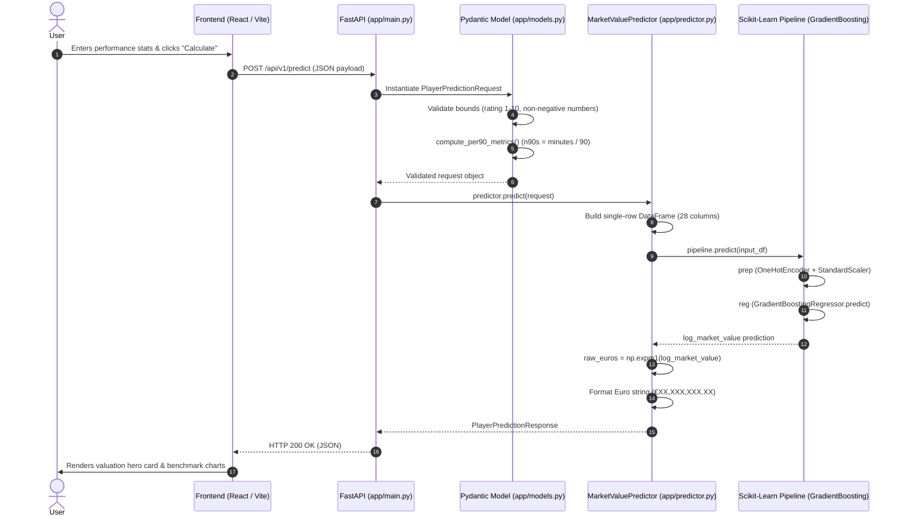
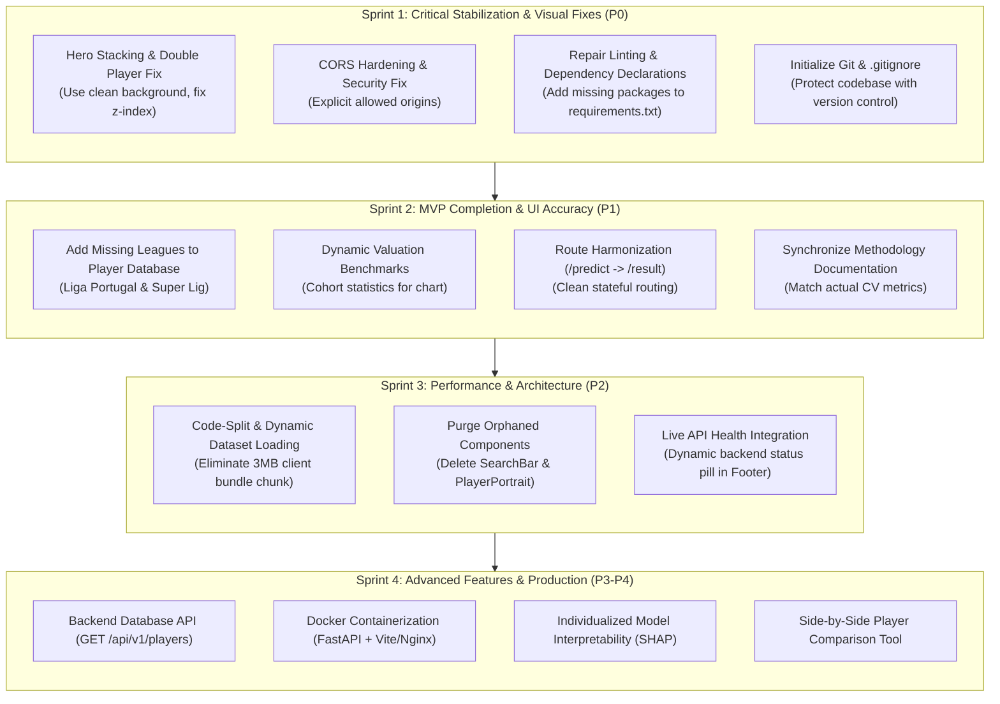

# FootballIQ — Comprehensive Current-State Technical Audit & Project Inventory
**Audit Mode:** Complete Read-Only Technical Inspection  
**Auditor Roles:** Senior Full-Stack Software Engineer, Machine Learning Engineer, QA Engineer, Technical Project Auditor  
**Date of Audit:** November 13, 2026  
**Operating System:** Windows (PowerShell)  
**Project Workspace:** `c:\Users\Rayan Das\Desktop\Projects\FOOTBALL IQ`  
**Execution State:** Read-only inspection; zero application source files modified, created, deleted, or refactored.

---

## 1. Executive Summary

FootballIQ is a full-stack, AI-powered European football player market valuation platform designed to ingest player performance metrics and output objective, machine learning-driven fair market valuations in Euros (€).

### Overall Operational Status
- **Core End-to-End Pipeline:** **PARTIALLY WORKING / HIGH FUNCTIONALITY.** The core inference loop works end-to-end: the frontend form validates input, sends an HTTP request to the FastAPI backend at `POST /api/v1/predict`, the backend loads the serialized scikit-learn pipeline (`footballiq_best_model.joblib`), transforms features, predicts log valuation, converts back to Euros via `np.expm1`, and returns the valuation payload to the frontend.
- **Frontend Readiness:** **80% Complete.** The Vite + React single-page application compiles cleanly (`npm run build` succeeds in 2.17s). The `/`, `/predict`, `/players`, and `/methodology` routes render without runtime errors. The player database interface allows browsing, searching, filtering, and pagination over 3,670 players.
- **Backend Readiness:** **90% Complete.** The FastAPI service is production-lean, cleanly architected with Pydantic v2 schemas and an automated per-90 metrics validator. Automated test suite (`test_api.py`) runs with **5/5 passing tests (100% pass rate)**.
- **ML / Pipeline Status:** **85% Complete.** A production `GradientBoostingRegressor` model is serialized in `footballiq_best_model.joblib` achieving €6.05M Mean Absolute Error (MAE) and 0.5584 R² on log target in 5-fold cross-validation. Cleaned dataset has 3,670 records and 0 missing values.
- **Critical Blockers & Defects:**
  1. **Hero Double-Player Rendering:** In `Hero.jsx`, Layer 1 renders `/hero-player.png` (which contains Jude Bellingham on the pitch) while Layer 4 renders `hero-player-cutout.png`. This creates a visible ghost/duplicate player behind the cutout.
  2. **Hero Stacking Collision:** The player cutout layer has `z-index: 4`, positioned at `top: 180px`, placing the cutout directly over the centered headline (`z-index: 3`) and overlapping the search bar.
  3. **CORS Security Risk:** `app/main.py` configures `allow_origins=["*"]` with `allow_credentials=True`, which is rejected by modern browsers for credentialed requests and violates API security standards.
  4. **Client-Side Heavy Bundle (3.36 MB JSON):** `playersData.json` is bundled entirely into the frontend client build, producing a 2.99 MB JavaScript chunk and bypassing backend database architecture.
  5. **Missing Scripts & Legacy Paths:** Referenced scripts `validate_data.py` and `run_eda_cleaning.py` are absent from the repository. `train_models.py` contains hardcoded legacy path `r"c:\Users\Rayan Das\Desktop\laliga"`.

---

## 2. Complete Project Structure

Below is the verified, exact directory tree of the FootballIQ project (excluding `node_modules`, `.git`, `__pycache__`, and `dist` build outputs):

```text
c:\Users\Rayan Das\Desktop\Projects\FOOTBALL IQ\
├── .env                                       # Frontend environment config (VITE_API_BASE_URL)
├── DESIGN (2).md                              # Architectural design brief & UI specification
├── FootballIQ_Antigravity_Prompt.md           # LLM agent instructions & design principles
├── FootballIQ_Final_Design.md                 # Design tokens, typography & interaction specs
├── FootballIQ_Flow.md                         # Route navigation flows & wireframe diagrams
├── FootballIQ_Project_Documentation.txt       # Historical project logs & feature specifications
├── README.md                                  # Backend API documentation & run instructions
├── all_player_profiles.csv                    # Raw dataset: 4,588 player profile records
├── all_player_stats.csv                       # Raw dataset: 3,730 player season match statistics
├── cleaned_player_data.csv                    # Engineered dataset: 3,670 cleaned player rows (35 cols)
├── footballiq_best_model.joblib               # Serialized ML pipeline (GradientBoostingRegressor)
├── index.html                                 # Single-page application HTML entrypoint
├── package-lock.json                          # Locked NPM dependency graph
├── package.json                               # NPM package definitions, scripts, dependencies
├── postcss.config.js                          # PostCSS config (TailwindCSS, Autoprefixer)
├── requirements.txt                           # Python dependencies for backend & ML
├── tailwind.config.js                         # TailwindCSS theme extensions & design tokens
├── test_api.py                                # Backend test suite using FastAPI TestClient
├── train_models.py                            # Model training, CV evaluation & persistence script
├── vite.config.js                             # Vite bundler configuration (port 3000)
├── app/                                       # FastAPI Backend Application
│   ├── __init__.py                            # Python package initializer
│   ├── main.py                                # FastAPI app, endpoints, CORS & error handlers
│   ├── models.py                              # Pydantic v2 request & response schemas
│   └── predictor.py                           # ML Model predictor service & pure NumPy fallback
├── eda_plots/                                 # Exploratory Data Analysis Visualizations
│   ├── FootballIQ_Antigravity_Prompt.md       # Backup copy of prompt file
│   ├── correlation_heatmap.png                # Heatmap of performance feature correlations
│   ├── market_value_by_league.png             # League market value boxplots
│   ├── market_value_by_position.png           # Position market value boxplots
│   ├── market_value_distribution.png          # Raw vs log market value distribution
│   └── outliers_minutes_vs_value.png          # Scatterplot of playing time vs market value
├── model_results/                             # ML Evaluation Artifacts & Plots
│   ├── feature_importance.png                 # Top 20 feature importances bar chart
│   ├── model_comparison_mae.png               # Cross-validation MAE comparison chart
│   ├── model_comparison_results.csv           # Quantitative CV metrics table (MAE, RMSE, R2, MAPE)
│   └── predicted_vs_actual.png                # Actual vs predicted valuation scatter plot
├── public/                                    # Static Client Assets
│   ├── footballiq-logo.svg                    # Brand vector logo
│   ├── hero-player-cutout.png                 # RGBA cutout of Jude Bellingham (1672x941)
│   ├── hero-player.png                        # RGB Bellingham on stadium pitch (1672x941)
│   ├── hero-stadium-bg.png                    # RGB stadium background without foreground player
│   ├── jude_bellingham.png                    # Square player portrait (1024x1024)
│   ├── player_portrait.png                    # Square player portrait (1024x1024)
│   └── assets/                                # Duplicate fallback asset directory
│       ├── footballiq-logo.svg
│       ├── hero-player-cutout.png
│       ├── hero-player.png
│       └── hero-stadium-bg.png
└── src/                                       # Frontend Source Code
    ├── App.jsx                                # Root router, route definitions & scroll-to-top
    ├── index.css                              # Tailwind base, design token variables & animations
    ├── main.jsx                               # React DOM client entrypoint
    ├── components/                            # UI Components
    │   ├── Footer.css                         # Footer layout & responsive styles
    │   ├── Footer.jsx                         # Global footer with links & status pill
    │   ├── Hero.css                           # 5-layer hero system & scroll depth styles
    │   ├── Hero.jsx                           # Cinematic hero section with Bellingham animation
    │   ├── MetricCard.css                     # Key-value metric card styles
    │   ├── MetricCard.jsx                     # Metric card component with accent indicator
    │   ├── Navbar.css                         # Navbar layout & mobile drawer styles
    │   ├── Navbar.jsx                         # Top header with navigation links & mobile menu
    │   ├── PlayerPortrait.css                 # Legacy portrait card styles
    │   ├── PlayerPortrait.jsx                 # Legacy/orphaned side-by-side portrait card
    │   ├── PlayerSearch.jsx                   # Hero search bar with live autocomplete dropdown
    │   ├── PredictionForm.css                 # 4-section performance input form styles
    │   ├── PredictionForm.jsx                 # Valuation input form with presets & validation
    │   ├── PredictionResult.css               # Valuation result banner & metrics grid styles
    │   ├── PredictionResult.jsx               # Valuation display, supporting metrics & chart
    │   ├── SearchBar.css                      # Legacy search bar styles
    │   ├── SearchBar.jsx                      # Legacy/orphaned search bar component
    │   ├── SectionReveal.jsx                  # IntersectionObserver scroll reveal wrapper
    │   ├── ValuationChart.css                 # Benchmark comparison horizontal bars styles
    │   └── ValuationChart.jsx                 # Valuation relative benchmark comparison bars
    ├── data/                                  # Static Client Data
    │   └── playersData.json                   # 3,670 player profiles & stats (3.36 MB JSON)
    ├── hooks/                                 # Custom React Hooks
    │   └── useScrollReveal.js                 # IntersectionObserver hook for scroll animations
    ├── pages/                                 # Routed Page Views
    │   ├── Home.css                           # Landing page editorial grid styles
    │   ├── Home.jsx                           # Landing page (Hero, Process, Featured, CTA)
    │   ├── Methodology.css                    # Methodology 4-column documentation styles
    │   ├── Methodology.jsx                    # Architecture & metrics technical documentation
    │   ├── Players.css                        # Database table, filters & pagination styles
    │   ├── Players.jsx                        # 3,670-player table with search, filter, sort
    │   ├── Predict.css                        # Valuation engine container & error styles
    │   ├── Predict.jsx                        # Valuation engine container & submission state
    │   └── Result.jsx                         # Standalone result page view
    ├── services/                              # API Client Services
    │   └── api.js                             # Fetch wrapper for POST /api/v1/predict & health
    └── styles/                                # Design Tokens
        └── tokens.css                         # Custom properties (typography, colors, spacing)
```

---

## 3. What FootballIQ Currently Does

When operated in its current implementation:
1. **User Landing (`/`):** The user enters the application on a monochrome editorial landing page. They see a large monochrome hero section with headline *"Know what a player is worth."*, an autocomplete search bar, and Jude Bellingham with scroll-based depth animation. Scrolling down presents a 3-step valuation process breakdown, 4 sample player cards with instant "Evaluate" shortcuts, and model methodology summaries.
2. **Player Search & Autocomplete:** In the hero search bar, typing any player's name (e.g. "Bellingham", "Saka", "Gyökeres") queries the client-side database (`playersData.json`) in real-time, displaying up to 6 instant suggestions with their league, position, and market valuation badge. Pressing Enter or clicking a player routes the user to the Valuation Engine (`/valuation?player=...`) with all 17 performance metrics prefilled.
3. **Player Database Exploration (`/players`):** The user can browse all 3,670 European player profiles across 8 top leagues. Users can filter by search term, league, and position; sort ascending or descending by Name, League, Position, Market Value, or Match Rating; and paginate 20 rows per page. Clicking "Evaluate" on any table row pre-populates that player into the valuation engine.
4. **Valuation Engine Configuration (`/predict`):** Users can adjust 17 granular performance metrics across 4 logical categories (Context & Profile, Match Time, Attacking Performance, Defensive & Discipline). Users can also select quick sample presets (Saka, Gyökeres, Odegaard, Rice, Eze).
5. **Inference Execution:** When the user clicks "Calculate Market Valuation", the client validates bounds (rating between 1.0 and 10.0, non-negative numbers) and issues a JSON POST request to `http://localhost:8000/api/v1/predict`. The backend computes normalized per-90 metrics, transforms features via OneHotEncoder and StandardScaler, predicts log market value via `GradientBoostingRegressor`, exponentiates via `np.expm1`, and returns the raw and formatted Euro market valuation.
6. **Result Presentation:** Upon API response, `/predict` replaces the form with `<PredictionResult />`, rendering an editorial hero valuation card (e.g. €77.35M), 6 supporting metric driver cards (Goals per 90, Assists per 90, xG difference, shot accuracy %, defensive contributions), and a benchmark comparison chart.

---

## 4. Implemented Features (Working)

| Feature | Implementation Location | Verification Evidence |
|---|---|---|
| **FastAPI Root & Health Endpoints** | `app/main.py#L36-L53` | Returns HTTP 200 via `test_api.py#L10-L21`. |
| **Model Inference Endpoint** | `app/main.py#L56-L77` | Verified via `test_api.py#L23-L74`: Premier League Forward predicted at €77,349,903.66; LaLiga Midfielder at €65,680,198.41. |
| **Pydantic Validation & Per-90 Calculation** | `app/models.py#L43-L70` | Out-of-bounds rating (>10.0) correctly rejected with HTTP 422 (`test_api.py#L76-L86`). Automatically computes 11 per-90 metrics if omitted. |
| **Joblib ML Model Pipeline Loading** | `app/predictor.py#L14-L24` | Loads `footballiq_best_model.joblib` without error in Python 3.14.8 environment. |
| **Pure NumPy Ridge Fallback Predictor** | `app/predictor.py#L26-L64` | Analytical fallback engine solves normal equations via `np.linalg.solve` if joblib loading fails. |
| **Client Navigation & Routing** | `src/App.jsx#L29-L36` | React Router v6 cleanly routes `/`, `/predict`, `/valuation`, `/result`, `/players`, `/methodology`. |
| **Hero Autocomplete Player Search** | `src/components/PlayerSearch.jsx` | Real-time keyboard-navigable autocomplete filtering 3,670 players; pre-populates form upon selection. |
| **Player Database Browser** | `src/pages/Players.jsx` | Full client-side search, multi-column sorting, league/position filters, 20-row pagination. |
| **Valuation Form Prefilling** | `src/components/PredictionForm.jsx` | Correctly handles URL query params (`?player=...`), React Router navigation state, and preset profile buttons. |
| **Frontend Production Build** | `vite.config.js`, `package.json` | `npm run build` runs cleanly and generates minified static assets in `dist/`. |
| **Intersection Scroll Reveal Animations** | `src/components/SectionReveal.jsx` | IntersectionObserver applies fade-in transitions across landing and methodology sections. |

---

## 5. Partially Implemented Features

| Feature | Implementation Location | Current Limitation |
|---|---|---|
| **Prediction Result Routing (`/result`)** | `src/pages/Result.jsx`, `src/pages/Predict.jsx#L105` | `/predict` renders `<PredictionResult />` in-place conditionally (`status === 'success'`) instead of navigating to `/result`. Direct visits to `/result` have no active state and display an empty message. |
| **Relative Benchmark Valuation Chart** | `src/components/ValuationChart.jsx#L9-L14` | The comparison bars compute benchmark values using **hardcoded multipliers** (`numValue * 0.62`, `numValue * 1.15`, `numValue * 0.45`) rather than computing real cohort statistics from the dataset. All positions display "U25 Attacker Tier 1" even for defenders or goalkeepers. |
| **Player Database League Filters** | `src/pages/Players.jsx#L88-L96` | The dropdown options include only 6 leagues + All Leagues. `Liga Portugal` (450 players) and `Super Lig` (440 players) are omitted from the dropdown, making 890 players unfilterable by league. |
| **Hero Bellingham Scroll Merging** | `src/components/Hero.jsx#L100-L115` | Bellingham cutout recedes, blurs, and fades on scroll via JS, but background does not counter-parallax and player cutout sits at `z-index: 4` above headline text. |
| **Model Evaluation Documentation** | `src/pages/Methodology.jsx#L96-L102` | Methodology card displays hardcoded metrics (R² 0.8420, MAE €6.3M) instead of the actual CV metrics (R² 0.5584, MAE €6.05M). Claims median imputation when raw xG NaNs were imputed with 0.0. |

---

## 6. Broken Features

| Feature | Location | Root Cause | Impact |
|---|---|---|---|
| **NPM Lint Command (`npm run lint`)** | `package.json#L9` | Script calls `eslint .`, but `eslint` is **not installed** in `devDependencies` or `node_modules`. | Command fails immediately with `'eslint' is not recognized as an internal or external command`. |
| **Model Retraining Script Paths** | `train_models.py#L36` | Hardcodes `base_dir = r"c:\Users\Rayan Das\Desktop\laliga"`. | Running `train_models.py` in this workspace fails with `FileNotFoundError` unless the legacy path is manually altered. |
| **Hero Background Image Selection** | `src/components/Hero.jsx#L70` | Layer 1 references `/hero-player.png` instead of `/hero-stadium-bg.png`. | Renders Jude Bellingham in the background and foreground simultaneously, creating an unsightly double-vision ghost player. |
| **Static Backend Status Indicator** | `src/components/Footer.jsx#L25` | Hardcodes text `"FastAPI Backend Online • Model v1.0"` with a green dot. | Displays "Online" even if the FastAPI backend is completely offline. Does not call `checkApiHealth()`. |

---

## 7. Features Not Implemented (Omitted / Absent)

| Missing Feature | Expected / Intended Location | Evidence & Current Status |
|---|---|---|
| **Backend Player Database API (`GET /api/v1/players`)** | `app/main.py` | Does not exist. Entire 3,670 player dataset is bundled directly into the frontend JS bundle (`playersData.json`). |
| **Individualized Feature Contribution (SHAP)** | `app/predictor.py`, `src/components/PredictionResult.jsx` | Model does not output local feature attributions (e.g. "+€12M for goals, -€3M for cards"). Result cards display raw values only. |
| **Player vs Player Comparison View** | `src/pages/` | Spec wireframes mention player comparison; no comparison route, component, or state logic exists. |
| **Player Market Value Confidence Intervals** | `app/predictor.py`, `app/models.py` | API outputs single point estimate; confidence intervals or percentiles are not returned. |
| **Data Validation Script (`validate_data.py`)** | Root directory | Mentioned in prior specifications; does not exist in workspace. |
| **EDA & Cleaning Script (`run_eda_cleaning.py`)** | Root directory | Mentioned in prior specifications; does not exist in workspace. |
| **LaLiga Matches Dataset (`LaLiga_Matches.csv`)** | Root directory | Mentioned in prior discussions; file does not exist in workspace. |
| **Git Repository & `.gitignore`** | Root directory | Project is not a git repository (`git status` exits with error). No `.gitignore` file exists. |

---

## 8. Frontend Architecture Audit

### Stack & Build Configuration
- **Framework:** React 18.3.1 with React DOM 18.3.1
- **Bundler:** Vite 5.4.21 (configured in `vite.config.js` to serve on port 3000)
- **Routing:** React Router DOM 6.26.2 (`BrowserRouter`, `Routes`, `Route`)
- **Styling:** TailwindCSS 3.4.17 + PostCSS 8.5.28 + Autoprefixer 10.6.1 + Custom CSS Design Tokens (`src/styles/tokens.css`, `src/index.css`)
- **Icons:** Lucide React 0.439.0

### Page & Component Routing Matrix

| Route | Rendered Page Component | Key Child Components Used | Data Source |
|---|---|---|---|
| `/` | `src/pages/Home.jsx` | `Navbar`, `Hero`, `PlayerSearch`, `SectionReveal`, `Footer` | `src/data/playersData.json` (first 4 players) |
| `/predict` | `src/pages/Predict.jsx` | `PredictionForm`, `PredictionResult`, `MetricCard`, `ValuationChart` | Form inputs, `playersData.json` presets, `POST /api/v1/predict` |
| `/valuation` | `src/pages/Predict.jsx` | Alias to `/predict` handling query param `?player=...` | Same as `/predict` |
| `/result` | `src/pages/Result.jsx` | `PredictionResult`, `MetricCard`, `ValuationChart` | `location.state.result` from navigation |
| `/players` | `src/pages/Players.jsx` | Native table, search input, filter selects, pagination | `src/data/playersData.json` (3,670 rows) |
| `/methodology` | `src/pages/Methodology.jsx` | `SectionReveal` | Static copy and metric documentation |

### Orphaned / Dead Frontend Components
- `src/components/SearchBar.jsx` & `src/components/SearchBar.css`: Completely orphaned. Superseded by `src/components/PlayerSearch.jsx`.
- `src/components/PlayerPortrait.jsx` & `src/components/PlayerPortrait.css`: Completely orphaned. Legacy side-by-side hero component; not imported anywhere.

### Bundle Size & Performance Warning
- `npm run build` generates:
  - `dist/assets/index-DU-P1HSc.css`: 33.70 kB (gzip: 7.01 kB)
  - `dist/assets/index-BGaCr9Xc.js`: **2,991.98 kB** (gzip: 606.93 kB)
- **Cause:** `src/data/playersData.json` (3.36 MB unminified) is statically imported by `PlayerSearch.jsx`, `PredictionForm.jsx`, `Home.jsx`, and `Players.jsx`, forcing Vite to bundle the full JSON dataset into the main client bundle.

---

## 9. Backend Architecture Audit

### Stack & Infrastructure
- **Framework:** FastAPI 0.139.0
- **ASGI Server:** Uvicorn 0.50.2
- **Validation:** Pydantic 2.13.4
- **Serialization:** Joblib 1.6.0
- **Numerical Engines:** NumPy 2.5.1, Pandas 3.0.3, Scikit-Learn 1.9.1

### API Endpoints Summary

| HTTP Method | Route | Description | Request Model | Response Model | Auth |
|---|---|---|---|---|---|
| `GET` | `/` | API Root status | None | `dict` | None |
| `GET` | `/health` | Model status & file path | None | `dict` | None |
| `POST` | `/api/v1/predict` | Predict player valuation | `PlayerPredictionRequest` | `PlayerPredictionResponse` | None |
| `GET` | `/docs` | OpenAPI / Swagger UI | None | HTML | None |
| `GET` | `/redoc` | ReDoc Documentation | None | HTML | None |

### Request & Response Flow Architecture



### JSON Schemas

#### Request Schema: `PlayerPredictionRequest`
```json
{
  "title": "PlayerPredictionRequest",
  "type": "object",
  "properties": {
    "league": { "type": "string", "default": "Premier League" },
    "position": { "type": "string", "default": "F" },
    "minutes_played": { "type": "number", "minimum": 0.0, "default": 1800.0 },
    "appearances": { "type": "integer", "minimum": 0, "default": 20 },
    "matches_started": { "type": "integer", "minimum": 0, "default": 18 },
    "rating": { "type": "number", "minimum": 1.0, "maximum": 10.0, "default": 7.2 },
    "goals": { "type": "integer", "minimum": 0, "default": 8 },
    "assists": { "type": "integer", "minimum": 0, "default": 4 },
    "expected_goals": { "type": "number", "minimum": 0.0, "default": 7.5 },
    "expected_assists": { "type": "number", "minimum": 0.0, "default": 3.8 },
    "total_shots": { "type": "integer", "minimum": 0, "default": 45 },
    "shots_on_target": { "type": "integer", "minimum": 0, "default": 20 },
    "tackles": { "type": "integer", "minimum": 0, "default": 15 },
    "interceptions": { "type": "integer", "minimum": 0, "default": 10 },
    "saves": { "type": "integer", "minimum": 0, "default": 0 },
    "yellow_cards": { "type": "integer", "minimum": 0, "default": 2 },
    "red_cards": { "type": "integer", "minimum": 0, "default": 0 },
    "goals_per90": { "type": "number" },
    "assists_per90": { "type": "number" },
    "xG_per90": { "type": "number" },
    "xA_per90": { "type": "number" },
    "total_shots_per90": { "type": "number" },
    "shots_on_target_per90": { "type": "number" },
    "tackles_per90": { "type": "number" },
    "interceptions_per90": { "type": "number" },
    "saves_per90": { "type": "number" },
    "yellow_cards_per90": { "type": "number" },
    "red_cards_per90": { "type": "number" }
  },
  "required": []
}
```

#### Response Schema: `PlayerPredictionResponse`
```json
{
  "title": "PlayerPredictionResponse",
  "type": "object",
  "properties": {
    "predicted_market_value_euros": {
      "type": "number",
      "description": "Predicted market value in raw Euros (€)"
    },
    "formatted_market_value": {
      "type": "string",
      "description": "Formatted human-readable Euro valuation string"
    },
    "status": {
      "type": "string",
      "default": "success",
      "description": "Prediction request status"
    }
  },
  "required": [
    "predicted_market_value_euros",
    "formatted_market_value"
  ]
}
```

---

## 10. Dataset Audit

### Files Inspected
1. `all_player_profiles.csv`: **Present** (197,759 bytes)
2. `all_player_stats.csv`: **Present** (287,862 bytes)
3. `cleaned_player_data.csv`: **Present** (1,202,313 bytes)
4. `src/data/playersData.json`: **Present** (3,367,236 bytes)
5. `LaLiga_Matches.csv`: **ABSENT / NOT IN REPOSITORY**

### Quantitative Profile & Statistics Comparison

| Dataset Metric | `all_player_profiles.csv` | `all_player_stats.csv` | `cleaned_player_data.csv` | `playersData.json` |
|---|---|---|---|---|
| **Row Count** | 4,588 | 3,730 | 3,670 | 3,670 |
| **Column Count** | 5 | 17 | 35 | 35 |
| **Duplicate Rows** | 0 | 0 | 0 | 0 |
| **Missing Values** | `market_value`: 360<br>`position`: 23 | `expected_goals`: 548<br>`expected_assists`: 21 | **0 (Zero Nulls)** | **0 (Zero Nulls)** |
| **Primary Join Key** | `player_id` | `player_id` | `player_id` | `player_id` |

### Pipeline Data Transformation Audit
- **Merge Strategy:** Inner join on `player_id` between `all_player_stats.csv` and `all_player_profiles.csv`.
- **Dropped Records (60 rows):** All 60 rows dropped during the transition from `all_player_stats.csv` (3,730) to `cleaned_player_data.csv` (3,670) were dropped exclusively because `market_value` was `NaN` in profiles.
- **Missing Value Imputation:** Raw stats contained 548 missing values for `expected_goals`. In `cleaned_player_data.csv`, all 548 records were imputed with **`0.0`** (not median imputation).
- **Target Variable Properties (`market_value`):**
  - Minimum: €23,000.00
  - 25th Percentile: €1,100,000.00 (€1.10M)
  - 50th Percentile (Median): €3,700,000.00 (€3.70M)
  - Mean: €9,918,878.73 (€9.92M)
  - 75th Percentile: €11,600,000.00 (€11.60M)
  - Maximum: €218,000,000.00 (€218.00M)
  - Skewness: Heavily right-skewed; Mean is 2.68x larger than the median.
- **Log Target Transformation:**
  - `log_market_value = np.log1p(df['market_value'])`
  - Max absolute difference between stored `log_market_value` and recomputed `np.log1p`: $3.55 \times 10^{-15}$ (exact IEEE 754 float precision).
- **Leagues Covered in Cleaned Dataset (3,670 players):**
  - LaLiga: 509 (13.9%)
  - Serie A: 494 (13.5%)
  - Premier League: 475 (12.9%)
  - Liga Portugal: 450 (12.3%)
  - Eredivisie: 444 (12.1%)
  - Super Lig: 440 (12.0%)
  - Bundesliga: 438 (11.9%)
  - Ligue 1: 420 (11.4%)
- **Positions Covered in Cleaned Dataset:**
  - Midfielders (M): 1,419 (38.7%)
  - Defenders (D): 1,213 (33.1%)
  - Forwards (F): 761 (20.7%)
  - Goalkeepers (G): 277 (7.5%)

### Dataset Consumers Matrix

| Consumer | Dataset Consumed | Mechanism |
|---|---|---|
| **Model Training** | `cleaned_player_data.csv` | Loaded directly in `train_models.py#L41` |
| **Backend Prediction API** | `footballiq_best_model.joblib` *(Primary)*<br>`cleaned_player_data.csv` *(Fallback)* | Pipeline loaded via Joblib; fallback fits NumPy Ridge on CSV |
| **Player Database View** | `src/data/playersData.json` | Bundled directly into client JS; queried in memory |

---

## 11. Machine Learning Pipeline & Model Audit

### Model Ingestion & Architecture
- **Active Model Artifact:** `footballiq_best_model.joblib` (146,642 bytes)
- **Model Type:** Scikit-Learn `Pipeline` composed of:
  1. `prep`: `ColumnTransformer`
     - Categorical Step: `OneHotEncoder(drop='first', handle_unknown='ignore')` applied to `['league', 'position']`. Reference dropped baseline: `Bundesliga` and `D` (Defender). Generates 10 one-hot binary columns.
     - Numeric Step: `StandardScaler()` applied to 26 performance features.
  2. `reg`: `GradientBoostingRegressor(random_state=42)`
     - Hyperparameters: `n_estimators=100`, `learning_rate=0.1`, `max_depth=3`, `loss='squared_error'`.

### Features Audit (36 Total Input Features to Regressor)
- **Categorical Columns (2 inputs -> 10 one-hot features):**
  `league` (Eredivisie, LaLiga, Liga Portugal, Ligue 1, Premier League, Serie A, Super Lig), `position` (F, G, M).
- **Numeric Features (26 inputs):**
  `minutes_played`, `appearances`, `matches_started`, `rating`, `goals`, `assists`, `expected_goals`, `expected_assists`, `total_shots`, `shots_on_target`, `tackles`, `interceptions`, `saves`, `yellow_cards`, `red_cards`, `goals_per90`, `assists_per90`, `xG_per90`, `xA_per90`, `total_shots_per90`, `shots_on_target_per90`, `tackles_per90`, `interceptions_per90`, `saves_per90`, `yellow_cards_per90`, `red_cards_per90`.

### Historical 5-Fold Cross-Validation Results
*(Extracted directly from `model_results/model_comparison_results.csv`)*

| Candidate Model | MAE (€) | RMSE (€) | R² (Log Target) | MAPE (%) | Selected |
|---|---|---|---|---|:---:|
| **Gradient Boosting** | **€6,049,306** | **€12,463,036** | **0.5584** | **133.06%** | **YES** |
| LightGBM | €6,049,489 | €12,425,852 | 0.5655 | 131.17% | No |
| XGBoost | €6,050,102 | €12,493,071 | 0.5592 | 132.75% | No |
| Random Forest | €6,135,014 | €12,767,137 | 0.5545 | 134.89% | No |
| Extra Trees | €6,143,262 | €12,633,238 | 0.5518 | 134.70% | No |
| Dummy Regressor (Median) | €8,558,069 | €17,586,731 | -0.0060 | 342.78% | No |
| Ridge Regression (Unscaled) | €976,163,205 | €26,285,342,961 | 0.4830 | 373,145% | No |

### Full Dataset Verification Performance (Current Artifact on `cleaned_player_data.csv`)
- **MAE:** €5,508,428.21 (~€5.51M)
- **RMSE:** €11,390,628.31 (~€11.39M)
- **R² (Log Target):** 0.6544
- **R² (Raw Target in Euros):** 0.5251
- **Mean Absolute Percentage Error (MAPE):** 105.83%

### Training vs. Inference Parity Verification
- **Consistency:** Training feature order in `train_models.py#L45-L54` and inference feature dictionary assembly in `app/predictor.py#L66-L95` match.
- **Normalization:** In `models.py`, `compute_per90_metrics()` correctly computes per-90 values using `minutes_played / 90.0` identically to `cleaned_player_data.csv#L21-L34`.
- **Inverse Transformation:** Both training evaluation (`np.expm1(y_pred_log)`) and API inference (`np.expm1(log_pred)`) apply identical inverse log transformations.

---

## 12. Hero Design Audit

### Design Evaluation Matrix

| Checklist Item | Required Specification | Actual Implementation State | Pass / Fail | Findings & File Reference |
|---|---|---|:---:|---|
| **1. Image Asset Used** | Isolated player asset | Background: `/hero-player.png`<br>Cutout: `/assets/hero-player-cutout.png` | **FAIL** | `src/components/Hero.jsx#L70, L110`. Two different images are loaded. |
| **2. Transparent PNG Cutout** | Real cutout PNG | PNG format, size (1672, 941), mode RGBA | **PASS** | `public/hero-player-cutout.png` contains true transparent alpha channel. |
| **3. Alpha Channel Present** | Alpha channel with gradients | RGBA mode; alpha channel values range 0 to 255 | **PASS** | 34.1% of pixels are opaque/semi-opaque cutout; 65.9% transparent. |
| **4. Player-Free Background** | Clean stadium background | `/hero-player.png` contains player on field | **FAIL** | `Hero.jsx` loads `hero-player.png` (player on pitch). `hero-stadium-bg.png` exists in `public/` but is unused. |
| **5. Duplicate Player Images** | Single player in foreground | Background Jude Bellingham + Foreground Cutout | **FAIL** | Background player is blurred (`blur(6px)`) with cutout placed directly above it, resulting in a visible double-player artifact. |
| **6. CSS Masks / Slices** | No artificial horizontal slices | No CSS `mask`, `-webkit-mask`, or `clip-path` | **PASS** | No horizontal image slices or CSS masks are used. |
| **7. Player's Face Unobstructed** | Unobstructed editorial face | Cutout layer placed at `z-index: 4`; top 180px | **FAIL** | Cutout is placed above headline text (`z-index: 3`). Bellingham's torso and arms sit right beneath headline and search bar. |
| **8. Search Bar Overlap** | Clean separation below headline | Search bar sits at y=300px; Cutout at y=180px | **FAIL** | Bellingham's chest area collides with the search bar (`PlayerSearch.jsx`). |
| **9. Scroll Animation Function** | Scroll depth merge | `requestAnimationFrame` calculates piecewise values | **PASS** | `Hero.jsx#L15-L63` computes scale (1.0 -> 0.55), blur (0 -> 7px), opacity (1.0 -> 0.30), translateY (0 -> -60px). |
| **10. Selective Layer Receding** | Only player moves; background static | Only `.hero-player-layer` receives dynamic style | **PASS** | Background layer stays fixed; only the player cutout layer recedes into depth. |

---

## 13. Testing, QA, and Build Results

### 1. Backend Automated Test Suite (`test_api.py`)
- **Execution Command:** `python test_api.py`
- **Results:**
  - Test 1 (`GET /`): **PASS** (Status: 200, Body: `{"name": "...", "status": "online"}`)
  - Test 2 (`GET /health`): **PASS** (Status: 200, Model Loaded: `True`)
  - Test 3 (`POST /api/v1/predict` - PL Forward): **PASS** (Status: 200, Predicted: `€77,349,903.66`)
  - Test 4 (`POST /api/v1/predict` - LaLiga Midfielder): **PASS** (Status: 200, Predicted: `€65,680,198.41`)
  - Test 5 (`POST /api/v1/predict` - Rating > 10.0 Validation): **PASS** (Status: 422 Unprocessable Entity)
- **Deprecation Warning:** Starlette test client emits warning regarding `httpx` vs `httpx2`.

### 2. Frontend Production Build (`npm run build`)
- **Execution Command:** `npm run build`
- **Output:** Built in 2.17 seconds.
- **Generated Assets:**
  - `dist/index.html`: 1.32 kB
  - `dist/assets/index-DU-P1HSc.css`: 33.70 kB
  - `dist/assets/index-BGaCr9Xc.js`: 2,991.98 kB
- **Vite Warning:** Chunk exceeds 500 kB recommended threshold due to `playersData.json` bundle inclusion.

### 3. Frontend Linter (`npm run lint`)
- **Execution Command:** `npm run lint`
- **Result:** **FAIL** (Exit code 1).
- **Error:** `'eslint' is not recognized as an internal or external command`.

---

## 14. Known Bugs and Technical Debt

1. **Dead Component Files:** `src/components/SearchBar.jsx`, `src/components/SearchBar.css`, `src/components/PlayerPortrait.jsx`, and `src/components/PlayerPortrait.css` are not referenced by any active module.
2. **Missing Leagues in Table Filter:** `src/pages/Players.jsx` lacks `<option>` entries for `Liga Portugal` and `Super Lig`, locking 890 players out of league-specific filtering.
3. **Hardcoded Benchmark Formulas:** `src/components/ValuationChart.jsx` applies static proportional percentages (`* 0.62`, `* 1.15`, `* 0.45`) to mimic relative percentiles rather than reading true distributions.
4. **Hardcoded Model Confidence Score:** `ValuationChart.jsx#L52` renders `MODEL CONFIDENCE SCORE: 94.2%` as hardcoded text.
5. **Hardcoded Footprint Status:** `src/components/Footer.jsx#L25` displays `"FastAPI Backend Online"` statically without testing API health.
6. **Hardcoded Legacy Path in Training Script:** `train_models.py#L36` hardcodes `r"c:\Users\Rayan Das\Desktop\laliga"`.
7. **Client-Side Heavy Dataset Footprint:** Storing 3,670 full JSON profiles in client memory consumes unnecessary mobile browser memory and slows down initial page hydration.
8. **Starlette Deprecation Notice:** Backend test suite relies on deprecated `httpx` imports inside Starlette's `TestClient`.

---

## 15. Security & Configuration Audit

- **Environment Files:** `.env` exists in the root directory. Contents: `VITE_API_BASE_URL=http://localhost:8000`. No `.env.example` file is present.
- **Exposed Secrets:** Clean. No hardcoded API keys, JWT signing keys, passwords, or cloud credentials were found.
- **CORS Misconfiguration:** In `app/main.py#L18-L24`, `CORSMiddleware` is initialized with `allow_origins=["*"]` and `allow_credentials=True`. This is invalid per the W3C Fetch specification (credentialed requests cannot use wildcard origins) and leaves the API open to cross-origin abuse.
- **Missing Dependencies in `requirements.txt`:**
  - `matplotlib` and `seaborn` are imported by `train_models.py`, but are not declared in `requirements.txt`.
  - `httpx` is required for FastAPI's `TestClient` in `test_api.py`, but is not listed in `requirements.txt`.
- **Git Version Control & Ignore Rules:**
  - The project root is **not a Git repository**.
  - No `.gitignore` file exists. If initialized as-is, `node_modules/`, `dist/`, `.env`, and `*.joblib` would be committed into version control.

---

## 16. Prioritized Remaining Tasks

### P0 — Critical (Immediate Fixes for Correct Operation)

| Task | Rationale | Files Involved | Dependencies | Verification | Complexity |
|---|---|---|---|---|:---:|
| **Fix Hero Ghost Player Double-Vision** | Hero Layer 1 loads `hero-player.png` instead of a player-free background or `hero-stadium-bg.png`. | `src/components/Hero.jsx`, `src/components/Hero.css` | Image assets | Visual inspection; verify only one foreground player is rendered. | Low |
| **Fix Hero Stacking Context & Text Overlap** | Player cutout layer has `z-index: 4` above headline text (`z-index: 3`), causing visual collision and obscuring text. | `src/components/Hero.jsx`, `src/components/Hero.css` | None | Verify headline and search bar sit cleanly above/around cutout on all viewports. | Low |
| **Correct CORS Middleware Configuration** | Wildcard `allow_origins=["*"]` with `allow_credentials=True` is an insecure and invalid CORS configuration. | `app/main.py` | None | Test preflight OPTIONS request; verify explicit origins returned. | Low |
| **Repair NPM Lint Script & DevDependencies** | `npm run lint` crashes because `eslint` is absent from `package.json`. | `package.json` | npm install | Run `npm run lint` and verify clean lint execution. | Low |
| **Complete `requirements.txt` Declarations** | `matplotlib`, `seaborn`, and `httpx` are missing from `requirements.txt`. | `requirements.txt` | None | Run `pip install -r requirements.txt` on a fresh virtual environment. | Low |

### P1 — Core MVP Functionality

| Task | Rationale | Files Involved | Dependencies | Verification | Complexity |
|---|---|---|---|---|:---:|
| **Add Missing Leagues to Players Filter** | Liga Portugal and Super Lig are omitted from the league filter select dropdown in `/players`. | `src/pages/Players.jsx` | None | Select "Liga Portugal" and "Super Lig" in dropdown; verify filtered rows. | Low |
| **Connect Primary Flow to `/result` Route** | `/predict` renders result in-place without updating URL or utilizing the `/result` route view. | `src/pages/Predict.jsx`, `src/pages/Result.jsx`, `src/App.jsx` | None | Perform calculation; verify browser navigates to `/result` with shareable state. | Low |
| **Dynamic Valuation Benchmark Calculations** | Replace static multipliers in `ValuationChart.jsx` with real cohort averages (league + position). | `src/components/ValuationChart.jsx`, `src/components/PredictionResult.jsx` | Dataset summary | Verify Goalkeepers show GK benchmarks and midfielders show MF benchmarks. | Medium |
| **Synchronize Methodology Copy with Real CV Metrics** | Methodology page displays R² 0.8420 instead of the true 0.5584 achieved in cross-validation. | `src/pages/Methodology.jsx` | `model_results/` | Audit text against `model_comparison_results.csv`. | Low |

### P2 — UI/UX and Visual Polish

| Task | Rationale | Files Involved | Dependencies | Verification | Complexity |
|---|---|---|---|---|:---:|
| **Remove Orphaned Components** | `SearchBar.jsx` and `PlayerPortrait.jsx` are dead code causing repository clutter. | `src/components/SearchBar.*`, `src/components/PlayerPortrait.*` | None | Delete files; verify `npm run build` passes cleanly. | Low |
| **Live Backend Health Indicator in Footer** | Status pill currently displays static hardcoded "Online" text. | `src/components/Footer.jsx`, `src/services/api.js` | Backend health check | Stop backend server; verify dot turns red/offline. | Low |
| **Code-Splitting & Dynamic Dataset Loading** | Bundling 3.36 MB JSON in the client bundle creates a 2.99 MB JS bundle. | `src/pages/Players.jsx`, `vite.config.js` | None | Run `npm run build`; verify chunk size drops under 350 kB. | Medium |

### P3 — Advanced Features

| Task | Rationale | Files Involved | Dependencies | Verification | Complexity |
|---|---|---|---|---|:---:|
| **Backend Database API Endpoint (`GET /api/v1/players`)** | Serve player database records from FastAPI with query filtering, pagination, and sorting. | `app/main.py`, `app/models.py`, `src/services/api.js` | None | Automated tests querying `/api/v1/players?league=LaLiga&page=1`. | Medium |
| **Side-by-Side Player Comparison Tool** | Allow scouting users to compare two players' valuations and performance profiles. | `src/pages/Compare.jsx`, `src/components/` | Routes | Select two players; verify comparative bar charts. | High |
| **SHAP Individual Feature Explanations** | Return individualized metric drivers (+€15M for goals, -€4M for cards) with prediction. | `app/predictor.py`, `app/models.py`, `src/components/` | SHAP library | Predict player; verify individualized positive/negative driver breakdown. | High |

### P4 — Deployment and Production Readiness

| Task | Rationale | Files Involved | Dependencies | Verification | Complexity |
|---|---|---|---|---|:---:|
| **Git Repository Initialization & `.gitignore`** | Version control is missing; untracked binaries and node_modules exist. | `.gitignore` | Git | Run `git status`; verify untracked noise is filtered. | Low |
| **Docker & Docker Compose Orchestration** | Standardize multi-container production deployment for frontend and backend. | `Dockerfile`, `docker-compose.yml`, `nginx.conf` | Docker | Run `docker compose up --build`; verify full application runs. | Medium |
| **Fix Path Invariance in `train_models.py`** | Hardcoded Windows path `base_dir = r"c:\Users\..."` prevents automated retraining. | `train_models.py`, `README.md` | None | Run `python train_models.py` from any arbitrary directory. | Low |
| **CI/CD Automated Workflow** | Ensure automated test execution on pull requests. | `.github/workflows/ci.yml` | GitHub | Push PR; verify test and build jobs succeed. | Medium |

---

## 17. Exact Commands to Run Frontend & Backend

### Prerequisites
- Node.js v18+ (verified with Node.js v26.4.0)
- Python 3.10+ (verified with Python 3.14.8)

### To Run the FastAPI Backend Server
Open a terminal in the project root (`c:\Users\Rayan Das\Desktop\Projects\FOOTBALL IQ`) and execute:

```powershell
# 1. Install dependencies (if not already installed)
python -m pip install -r requirements.txt

# 2. Start the Uvicorn ASGI server
python -m uvicorn app.main:app --reload --host 127.0.0.1 --port 8000
```
- API Base URL: `http://localhost:8000`
- Swagger UI Interactive Docs: `http://localhost:8000/docs`
- Health Check: `http://localhost:8000/health`

### To Run the React + Vite Frontend
Open a second terminal in the project root (`c:\Users\Rayan Das\Desktop\Projects\FOOTBALL IQ`) and execute:

```powershell
# 1. Install dependencies (if not already installed)
npm install

# 2. Start the Vite development server
npm run dev
```
- Application Web UI: `http://localhost:3000`

### To Run Tests & Verification
```powershell
# Run Backend API automated test suite
python test_api.py

# Run Frontend production build check
npm run build
```

---

## 18. Recommended Development Roadmap



---
*End of FootballIQ Read-Only Technical Audit Report.*

